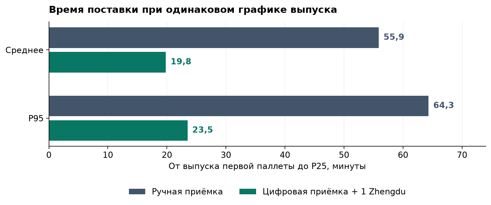
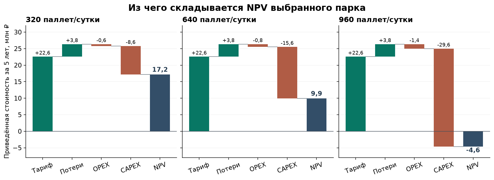

# Приёмка ПСВ от фасовки до складской ячейки

**Developed by Sychikov Vladimir.**
This project is publicly available as a contribution to the open-source and Codex community. Community contributions, feedback, and improvements are welcome.

[MIT License](LICENSE) · [Contributing](CONTRIBUTING.md)

На складе ПСВ паллета проходит путь от фасовки до подтверждённой ячейки. Здесь можно пройти этот путь от лица приёмщика в Odoo или воспроизвести расчёт времени и стоимости для 148 вариантов парка. Автор проекта и методики - Sychikov Vladimir. Расчётный срез от 26 ноября 2026 года.

## Посмотреть прототип на Windows

**[Скачать PSV-Prototype.exe](https://github.com/2303850Analyst/sibur-iot-ml-transformation/releases/download/prototype-v1.0.0/PSV-Prototype.exe)** и запустить двойным щелчком. На компьютере нужен Docker Desktop в режиме Linux containers. При первом запуске понадобится интернет для загрузки образов и зависимостей. После создания учебной базы откроется браузерный терминал сбора данных (ТСД) под учётной записью приёмщика.

Нажмите **«Сигнал IoT от IOT-01»**. Имитатор считывателя отправит код через MQTT. Когда Odoo зарегистрирует событие, на ТСД появятся сведения о паллете. Сверьте партию и количество, подтвердите приёмку, назначьте место и введите адрес ячейки. По ссылке «Открыть приёмку в Odoo» можно посмотреть сам складской документ. Повторный запуск сохраняет размещение. [Папка прототипа и инструкция](prototype/windows)

## Что даёт автоматизация

При одинаковом графике выпуска 320 паллет в сутки ручная приёмка занимает в среднем **55:54** на поставку. Цифровая приёмка с одним ричтраком Zhengdu и универсальным водителем - **19:49**. В обеих схемах все 64 поставки закрываются до полуночи. Эти значения получены на расчётном стенде. Для вывода о фактической длительности на предприятии нужен хронометраж. [Методика и полный реестр парков](writing/Финальная%20оценка%20Ex/Приёмка%20ПСВ%20-%20правила%20сравнения%20As-is%20и%20To-be.md)



| На поставку из пяти паллет | Ручной As-is 5.2 | Цифровая приёмка и один Zhengdu |
|---|---:|---:|
| Среднее время до P25 | 55 мин 54 с | 19 мин 49 с |
| P95 времени до P25 | 64 мин 20 с | 23 мин 30 с |
| Закрыто в день выпуска | 64 из 64 ежедневно | 64 из 64 ежедневно во всех трёх повторах |

Первая поставка начинается в 00:00, последняя - в 23:05. Паллеты одной поставки выходят с интервалом в две минуты. В ручной схеме работают приёмщик, два водителя на подвозе и один на укладке. Каждая паллета проходит десятиминутную проверку ОТК. В цифровой схеме склад заранее получает извещение, считывает SSCC, регистрирует подтверждения и выдаёт задания технике. Для паллет с действующим допуском в модели задана вероятность дополнительной физической проверки 1%. Решение о качестве принимает ОТК. В таблице для цифровой схемы приведён худший P95 из трёх месячных повторов. [Ручные длительности](writing/Финальная%20оценка%20Ex/As-is%20ПСВ%20-%20подбор%20ручных%20длительностей.csv) · [Сопоставимые суточные прогоны](writing/Финальная%20оценка%20Ex/As-is%20ПСВ%20-%20закрытие%20по%20суткам.csv)

## Исследовательский вклад и его границы

1. **Из чего складывается время поставки.** Для P01-P25 задано, кто выполняет операцию, сколько она длится и сколько раз повторяется. При расчёте учитываются параллельная работа и ожидание свободного человека, машины или поста. Это позволяет раздельно считать календарное время и человеко-минуты.
2. **Как выбрана ручная база.** Из 432 сочетаний длительностей 114 позволили закрыть суточный объём. В сценарии As-is 5.2 последняя поставка закрывается за 10 секунд до полуночи, приёмщик занят 98,5% времени. База подобрана по пропускной способности. Влияние реального разброса длительностей ещё предстоит проверить.
3. **Что входит в выигрыш.** Экономия 36 мин 05 с относится ко всей цифровой схеме. Для выделения вклада извещения, считывателя, политики ОТК, робота и проверок SAP нужны отдельные сравнения. Денежные составляющие уже можно проследить по годам в смете.

## Сколько машин окупается

В полной матрице вход круглосуточный. Для каждого из 444 сочетаний парка и нагрузки проведено три повтора, всего 1 332 плюс девять контрольных ручных прогонов. После одних суток прогрева моделируются 30 суток выпуска и до 72 часов на завершение. Парк проходит отбор, если во всех трёх повторах успевает завершить поставки и удерживает прирост очереди в пределах допуска методики. Из этих парков выбирается вариант с наибольшим NPV.

| Паллет/сутки | Устойчивых парков из 148 | Выбранный парк по NPV | Вложения, млн ₽ | NPV за 5 лет, млн ₽ |
|---:|---:|---|---:|---:|
| 320 | 127 | 1 Zhengdu и 1 универсальный водитель | 8,62 | **+17,16** |
| 640 | 110 | 2 Zhengdu и 1 водитель на подвозе | 15,61 | **+9,91** |
| 960 | 84 | 4 Zhengdu и 1 водитель на укладке | 29,59 | **−4,60** |



«Тариф» - предполагаемое снижение оплаты подрядчика за водительские часы, «Потери» - предотвращённые списания и уценка. В исходной смете для трёх выбранных парков приняты 7,66 и 1,36 млн ₽ за полный год соответственно. В первый год реализуется 80% эффекта по потерям. Денежные потоки индексируются на 7% начиная со второго года, ставка дисконта - 25,91%. При 960 паллетах в сутки выбранный парк выдерживает нагрузку, но его вложения превышают приведённую выгоду. Для инвестиционного решения нужны условия договора, подтверждённая стоимость исполнения Ex и документы на конкретную комплектацию. [Расчётная книга](writing/Финальная%20оценка%20Ex/Приёмка%20ПСВ%20-%20148%20парков%20без%20зарядных%20пауз.xlsx) · [Входные данные сметы](reproduction/psv/reference/fleets.tsv)

## Воспроизведение

**Модель ПСВ.** Из корня репозитория выполните команду с установленным Node.js современной LTS-версии. Дополнительные пакеты для этого прогона не нужны.

```shell
node reproduction/psv/reproduce.mjs
```

Команда проверяет SHA-256 зафиксированных материалов, времена изолированной поставки (3 120 и 900 секунд), все 30 дней As-is 5.2, результаты 148 парков при трёх нагрузках и NPV победителей. Она повторяет подбор 432 сочетаний, сравнивает выходные файлы с эталонами и сохраняет новый расчёт в отдельной папке внутри `reproduced/`. Последняя строка успешного прогона начинается с `PASS`.

**Интеграционные испытания для разработчика.** Исходный стенд проверяет обмен событиями и складские проводки в Odoo 19 Community с PostgreSQL 16 и Mosquitto. Для запуска автоматических испытаний из корня проекта нужны Windows, PowerShell 7 и Docker Desktop.

```powershell
pwsh -File ./run_all.ps1 -Scope Integration
```

При первом запуске создаётся локальный файл доступа. История действующих и архивных исследований, запуск более ранней матрицы и адреса сервисов описаны в [руководстве стенда](docs/stand-original.md). Для работы с переносимой копией используйте `git clone -b test/ablation-sensitivity <путь-к-bundle> psv-inbound-lab`.

## Карта репозитория

| Каталог | Содержание |
|---|---|
| [deployment_pilots/pallet_flow](deployment_pilots/pallet_flow) | Модель P01-P25, подбор ручных длительностей, расчёт парка и суточного баланса |
| [reproduction/psv](reproduction/psv) | Запуск регрессии, эталонные результаты, входная матрица, контрольные суммы и построение графиков |
| [writing/Финальная оценка Ex](writing/Финальная%20оценка%20Ex) | Действующая методика, книги Excel, таблицы CSV и предыдущие редакции |
| [experiment_v3](experiment_v3), [experiment_v2](experiment_v2), [series_py312](series_py312) | Предшествующие серии, протоколы, параметры и журналы. У каждой серии свой статус испытаний |
| [odoo_addons](odoo_addons), [scripts](scripts), [artifacts](artifacts) | Модуль Odoo, запуск интеграционного контура и записи испытаний |
| [data/raw](data/raw) | Исходные данные WEPAStacks для прежней серии и условия их использования |

Архивные каталоги `artifacts/attempt_host_py313` и `series_py312/artifacts_obsolete_serialization` сохраняют историю попыток. Принятые показатели ПСВ находятся в разделе «Финальная оценка Ex». Для технической упаковки, воспроизведения и подготовки графиков использовался OpenAI Codex. Правила внесения изменений приведены в [CONTRIBUTING.md](CONTRIBUTING.md).
