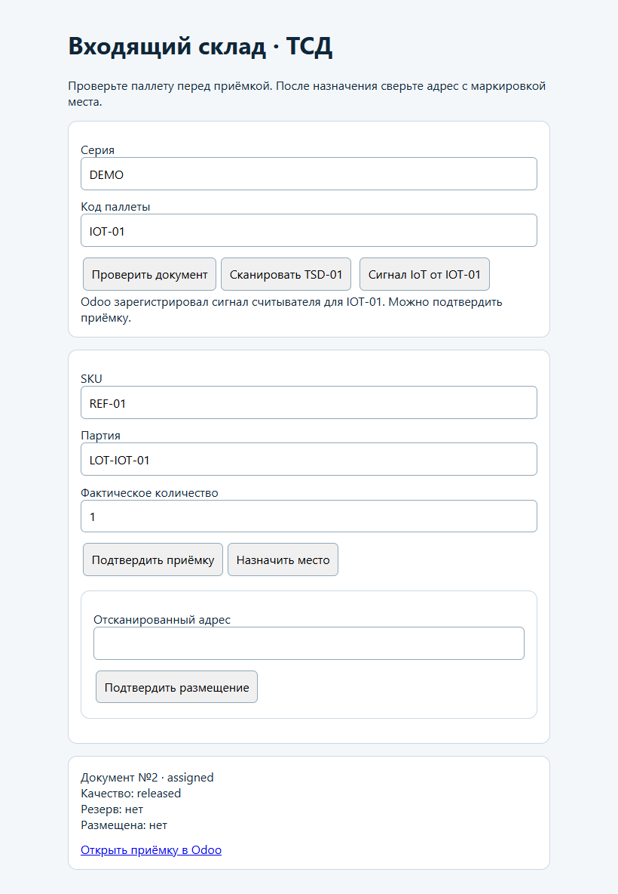

# Прототип приёмки ПСВ для Windows

**[Скачать PSV-Prototype.exe](https://github.com/2303850Analyst/sibur-iot-ml-transformation/releases/download/prototype-v1.0.0/PSV-Prototype.exe)**

Запустите файл двойным щелчком. Он развернёт учебный склад на компьютере и откроет в браузере рабочее место приёмщика. Для первого запуска нужны интернет и установленный Docker Desktop с Linux containers. Если Docker Desktop ещё не установлен, сначала установите его и дождитесь готовности движка. [Docker Desktop для Windows](https://docs.docker.com/desktop/setup/install/windows-install/)

## Принять первую паллету

1. Нажмите **«Сигнал IoT от IOT-01»**. Имитатор считывателя публикует событие в Mosquitto. Шлюз передаёт его в Odoo. ТСД покажет подтверждение после записи события в журнале.
2. Сверьте SKU, партию и количество. Нажмите **«Подтвердить приёмку»**, затем **«Назначить место»**. Адрес появится в строке «Резерв».
3. Введите этот адрес в поле **«Отсканированный адрес»** и нажмите **«Подтвердить размещение»**. В строке «Размещена» появится ячейка. По ссылке **«Открыть приёмку в Odoo»** доступен документ движения.
4. Для ручного сценария нажмите **«Сканировать TSD-01»**. В этом случае код поступает с браузерного ТСД. Дальше паллету принимает тот же сотрудник по тем же шагам.

## Как устроен запуск

Внутри EXE находятся файлы Compose, модуль Odoo, код IoT-шлюза и имитатор считывателя. Образы контейнеров загружаются отдельно. Установщик подготавливает шесть учебных паллет. Для входа в браузер он выдаёт одноразовую ссылку на две минуты с правами приёмщика. База PostgreSQL, остатки и задания сохраняются в томах Docker между запусками.

Другие стенды могут работать одновременно. В Docker Desktop этот проект называется `psv-user-prototype`. Порт Odoo назначается автоматически и доступен через `127.0.0.1`; адрес указан в окне запуска. Брокер и имитатор датчика работают во внутренней сети контейнеров. Рабочие файлы запуска хранятся в `%LOCALAPPDATA%\PSV-Prototype`.

Чтобы остановить прототип, нажмите **Stop** у проекта в Docker Desktop или выполните `.\PSV-Prototype.exe --stop` в PowerShell. Чтобы вернуться к своей базе, снова запустите EXE. Ключ `--no-browser` запускает сервисы без открытия окна ТСД.

## Для разработчика

| Путь | Содержание |
|---|---|
| [payload/compose.yaml](payload/compose.yaml) | Состав демонстрационного склада и адреса сервисов |
| [payload/odoo_addons/wms_research](payload/odoo_addons/wms_research) | Складской модуль, API, рабочее место ТСД и вход в демонстрацию |
| [payload/scripts](payload/scripts) | Подготовка учебной базы, имитатор MQTT-считывателя и доставка событий в Odoo |
| [launcher/Program.cs](launcher/Program.cs) и [build.ps1](build.ps1) | Исходный код Windows-программы и сборка EXE |
| [SHA256SUMS.txt](SHA256SUMS.txt) | Контрольная сумма опубликованного EXE |

Из каталога `prototype/windows` запустите `.\build.ps1` в PowerShell на Windows x64 с компилятором .NET Framework 4.x. Скрипт упакует содержимое `payload` внутрь `PSV-Prototype.exe`. Выпуск 1.0.0 распространяется без цифровой подписи издателя.

Демонстрация работает с тестовыми паллетами в Odoo 19 Community. Физические ТСД, датчики, ричтраки и подключение к промышленному SAP для просмотра не требуются. Числа о длительности процесса и NPV рассчитаны отдельно. [Методика и результаты](../../README.md)
